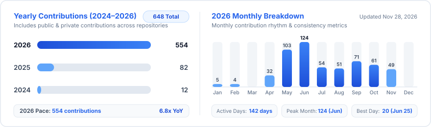

<!-- GitHub profile README · Amoor6 -->

# Amoor Navasartian

**Frontend Engineer** · React · Next.js · TypeScript

I build clear, resilient web experiences — from polished public-facing websites to data-heavy business applications. Currently working at **Webineh**, with a focus on thoughtful UI, maintainable frontend architecture, and the details that make a product feel right.

[Portfolio](https://portfolio-mu-blond-27.vercel.app/) · [LinkedIn](https://www.linkedin.com/in/amoor-navasartian-37515924a/) · [Email](mailto:amoor6navasartian@gmail.com)

---

### Selected work

**01 / [ArmAC Group](https://armac-group.ir/)**  
*A production website for a Persian-language HVAC services company.*  
Designed around responsive RTL interfaces, discoverable service content, and a practical Next.js architecture.  
`Next.js` · `TypeScript` · `Tailwind CSS` · `SEO` · [Live site](https://armac-group.ir/)

**02 / Workflow Automation Platform** · *Private work*  
*A product exploring smarter workflows and useful automation.*  
Building structured interfaces for complex business tasks, with an emphasis on clarity and maintainability.  
`React` · `TypeScript` · `Product UI`

**03 / Enterprise Reporting Interfaces** · *Private work*  
*Frontend systems for data-intensive business workflows.*  
Reusable interface patterns for reporting, filtering, and working with complex datasets and APIs.  
`React` · `TypeScript` · `REST APIs` · `Data UI`

---

### Engineering activity

<!-- Generated by .github/workflows/profile-visuals.yml after its first successful run. -->
<picture>
  <source media="(prefers-color-scheme: dark)" srcset="https://raw.githubusercontent.com/Amoor6/Amoor6/output/activity-dark.svg" />
  <source media="(prefers-color-scheme: light)" srcset="https://raw.githubusercontent.com/Amoor6/Amoor6/output/activity-light.svg" />
  
</picture>

GitHub contributions are not the same as commits. Counts may include anonymous private activity when allowed by GitHub's settings and API permissions. Commit counts cover activity accessible to the API token.

### Languages

<picture>
  <source media="(prefers-color-scheme: dark)" srcset="https://raw.githubusercontent.com/Amoor6/Amoor6/output/languages-dark.svg" />
  <source media="(prefers-color-scheme: light)" srcset="https://raw.githubusercontent.com/Amoor6/Amoor6/output/languages-light.svg" />
  
</picture>

Language proportions are based on GitHub's language classification of public repository code, not time spent coding. Private repositories are excluded from this chart.

### Contribution trail

<picture>
  <source media="(prefers-color-scheme: dark)" srcset="https://raw.githubusercontent.com/Amoor6/Amoor6/output/snake-dark.svg" />
  <source media="(prefers-color-scheme: light)" srcset="https://raw.githubusercontent.com/Amoor6/Amoor6/output/snake-light.svg" />
  
</picture>

---

**Currently exploring:** AI-assisted products, frontend architecture, and building better developer experiences.
