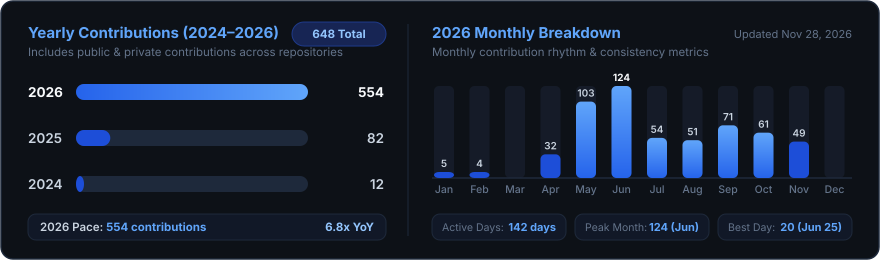

<!-- GitHub Profile README for github.com/Amoor6 -->

<div align="center">


### Building fast, scalable, and polished web experiences.

I turn complex requirements into clean interfaces, reusable components, and maintainable frontend systems.

<br />

<a href="https://portfolio-mu-blond-27.vercel.app/">
  
</a>
<a href="https://www.linkedin.com/in/amoor-navasartian-37515924a/">
  
</a>
<a href="mailto:amoor6navasartian@gmail.com">
  
</a>

<br />
<br />


</div>

---

## About Me

```ts
type DeveloperProfile = {
  readonly name: string;
  readonly role: "Frontend Engineer";
  readonly company: string;
  readonly stack: readonly string[];
  readonly architecture: readonly string[];
  readonly currentFocus: readonly string[];
  readonly philosophy: () => string;
};

const amoor: DeveloperProfile = {
  name: "Amoor Navasartian",
  role: "Frontend Engineer",
  company: "Webineh",
  stack: ["React", "Next.js", "TypeScript", "Tailwind CSS", "Redux"],
  architecture: ["Design Systems", "Data-Heavy Dashboards", "Performance & SEO", "RTL Interfaces"],
  currentFocus: [
    "Scalable Next.js & enterprise frontend architecture",
    "Real business workflows & backend integrations",
    "AI-powered developer workflows & product interfaces",
  ],
  philosophy: () => "Build clean. Ship confidently. Obsess over the details.",
} as const;
```

I’m a frontend developer focused on building responsive, accessible, and production-ready web applications.

At **Webineh**, I work on real-world frontend systems, connect interfaces to backend services, build data-heavy dashboards, and transform complex requirements into smooth user experiences.

My work usually lives somewhere between **clean engineering**, **good UX**, and an unreasonable obsession with spacing.

---

## Tech Stack

<div align="center">

### Core


### Tools & Infrastructure


</div>

---

## Featured Work

<table>
<tr>
<td width="50%" valign="top">

### 🌬️ ARM AC

A modern Persian HVAC website designed for performance, discoverability, and a smooth responsive experience.

**Highlights**

* SEO-friendly Next.js architecture
* Responsive Persian RTL interface
* Dynamic services and content
* Modern animations and UI sections
* Production-focused performance

**Stack**

`Next.js` `TypeScript` `Tailwind CSS` `Node.js` `SEO`

<br />

<a href="https://armac-group.ir">
  
</a>

</td>
<td width="50%" valign="top">

### 🧮 Budget Management Platform

A data-heavy financial management and reporting system developed for educational institutions.

**Highlights**

* Complex financial data tables
* Advanced filtering and reporting
* Role-based workflows
* Excel import and export
* Backend and SQL integrations

**Stack**

`React` `TypeScript` `SQL` `REST APIs` `Reporting UI`

<br />


</td>
</tr>

<tr>
<td width="50%" valign="top">

### 🌐 Developer Portfolio

My personal space for showcasing selected projects, technical skills, and frontend experiments.

**Highlights**

* Responsive project showcase
* Minimal modern interface
* Optimized page structure
* Smooth interactions
* Clear project presentation

**Stack**

`Next.js` `React` `Tailwind CSS` `Vercel`

<br />

<a href="https://portfolio-mu-blond-27.vercel.app/">
  
</a>

</td>
<td width="50%" valign="top">

### 🏗️ Frontend Systems

Reusable components and application interfaces built for real production workflows.

**What I Build**

* Admin panels and dashboards
* Reusable component systems
* Responsive landing pages
* Form-heavy business interfaces
* Maintainable Next.js applications

**Main Focus**

`Clean Code` `UX` `Performance` `Scalability`

<br />


</td>
</tr>
</table>

---

## GitHub Overview

<div align="center">

<picture>
  <source media="(prefers-color-scheme: dark)" srcset="https://raw.githubusercontent.com/Amoor6/Amoor6/output/activity-dark.svg" />
  <source media="(prefers-color-scheme: light)" srcset="https://raw.githubusercontent.com/Amoor6/Amoor6/output/activity-light.svg" />
  
</picture>

<br />
<br />


<br />
<br />

<picture>
  <source media="(prefers-color-scheme: dark)" srcset="https://raw.githubusercontent.com/Amoor6/Amoor6/output/snake-dark.svg" />
  <source media="(prefers-color-scheme: light)" srcset="https://raw.githubusercontent.com/Amoor6/Amoor6/output/snake-light.svg" />
  
</picture>

</div>

---

## What I Care About

<table>
<tr>
<td align="center" width="25%">

### ⚡

**Performance**

Fast applications and efficient user experiences.

</td>
<td align="center" width="25%">

### 🧩

**Reusability**

Components that remain useful beyond one page.

</td>
<td align="center" width="25%">

### 🎯

**User Experience**

Interfaces that feel clear, polished, and intentional.

</td>
<td align="center" width="25%">

### 🧼

**Clean Code**

Readable systems that developers can confidently maintain.

</td>
</tr>
</table>

---

<div align="center">

## Let’s Build Something Great

I’m always interested in meaningful projects, ambitious products, and conversations about frontend engineering.

<a href="https://portfolio-mu-blond-27.vercel.app/">
  
</a>
<a href="https://www.linkedin.com/in/amoor-navasartian-37515924a/">
  
</a>
<a href="mailto:amoor6navasartian@gmail.com">
  
</a>

<br />
<br />

> **Build with intention. Ship with confidence. Keep leveling up.**


</div>
